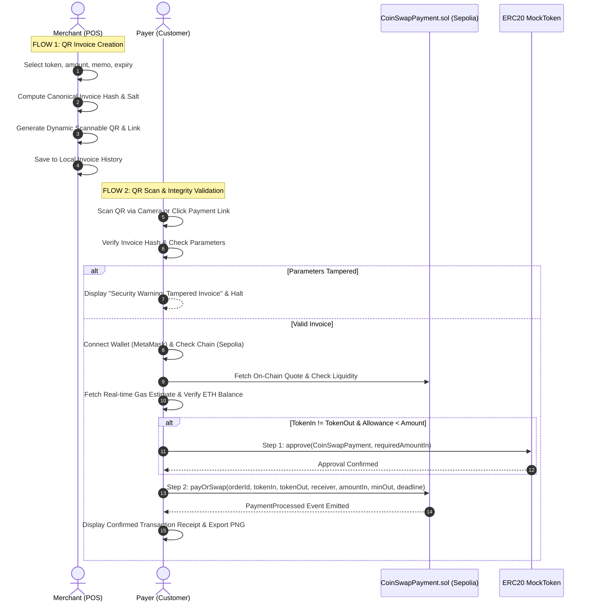

# BorderPay — Comprehensive Product User Flows
**Document ID:** BP-FLW-002  
**Author:** AGENT 02 (UI/UX Designer)  
**Date:** November 2026  

---

## 1. Flow Overview

---

## 2. Detailed Flow Specifications

### Flow 1: Merchant QR Generation & Management
1. **Entry:** User navigates to `/` (Terminal tab).
2. **Parameters Input:**
   - Recipient wallet address (can autofill connected address).
   - Target token currency (`mUSD`, `mEUR`, `mJPY`).
   - Nominal amount (with presets: 5, 10, 25, 50, 100).
   - Expiration window (5m, 15m, 1h, 24h).
   - Memo / Description.
3. **Canonical Hash Generation:**
   - Computes canonical cryptographic checksum:
     `keccak256(orderId, receiver, tokenOut, amount, deadline)`.
   - Incorporates `checksum` query parameter into the generated link.
4. **Output Presentation:**
   - Live High-ECC QR Code with scanline animation.
   - Dynamic countdown timer with expiration state.
   - Download QR as PNG with BorderPay branded card.
   - Copy payment link and order ID.
   - Automatic record added to Local Invoice History.

### Flow 2: Payer Checkout & Smart Contract Settlement
1. **Entry:** Payer opens `/pay?orderId=...&receiver=...&tokenOut=...&amount=...&deadline=...&memo=...&checksum=...`.
2. **Step 1 — Integrity & Expiration Gate:**
   - Recomputes canonical hash from parameters and compares to `checksum`.
   - If mismatch is detected: Renders Red Glass alert, disables payment actions, protects user from URL tampering.
   - If deadline < now: Renders Expired badge and blocks settlement.
3. **Step 2 — Wallet & Network Synchronization:**
   - Connects MetaMask / injected provider.
   - Detects chain ID: If not `0xaa36a7` (Sepolia), prompts automatic switch.
4. **Step 3 — Token Selection & Dynamic Quote:**
   - Displays all 3 mock tokens with user's live balance.
   - Queries `quoteRequiredIn()` from `CoinSwapPayment.sol`.
   - Informs payer if their balance is insufficient.
5. **Step 4 — Gas Estimation & Payment Preview:**
   - Queries Sepolia fee data and estimates gas limit for `approve` and `payOrSwap`.
   - Verifies whether user's Sepolia ETH is sufficient to cover gas.
6. **Step 5 — Execution Timeline:**
   - Awaiting Approval Signature -> Approval Pending -> Approval Confirmed.
   - Awaiting Swap/Pay Signature -> Blockchain Pending -> Confirmed on Sepolia.
7. **Step 6 — Receipt & Export:**
   - Shows verified receipt with txHash, block number, pair, input/output amounts.
   - Export receipt as high-resolution PNG image for record keeping.

### Flow 3: Interactive Swap Calculator & Simulation
1. Payer or Merchant opens `Rates & Calculator` tab.
2. Selects input token and output token from dropdowns.
3. Types nominal simulation amount; instant calculation executes using on-chain contract rates (`mockRates[in][out]`).
4. Invert button instantly flips input and output tokens.
5. Explanatory breakdown explains that rates are simulated on-chain rates (Kurs Simulasi), not live forex markets.

### Flow 4: Onboarding Walkthrough & Faucet Guide
1. User clicks `Panduan Web3 / Faucet` or opens for the first time.
2. Step 1: Explains Web3 wallets (MetaMask).
3. Step 2: Explains Ethereum Sepolia testnet and how to add it.
4. Step 3: Explains why Sepolia ETH is required for gas and provides official faucet links.
5. Step 4: Explains mock ERC-20 tokens (`mUSD`, `mEUR`, `mJPY`), their academic simulation nature, and how to mint them.
6. Step 5: Security warning: Never disclose seed phrases or private keys.
